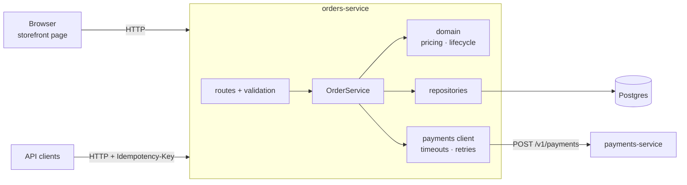
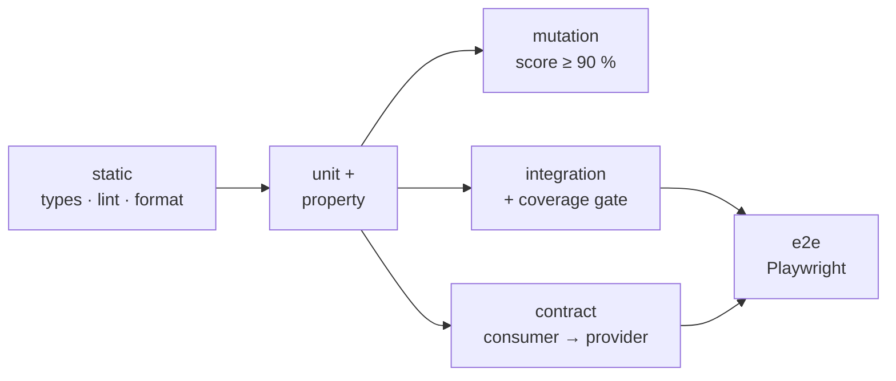

<div align="center">

# 🧭 test-architecture-showcase

**A complete, risk-based test architecture for a small but realistic order service.**

Unit · Property-based · Mutation · Integration (real Postgres) · Fault injection · Contract (Pact) · E2E (Playwright) · Quality gates in CI

[](https://github.com/sergiopiedra/test-architecture-showcase/actions/workflows/ci.yml)
[](https://github.com/sergiopiedra/test-architecture-showcase/actions/workflows/burn-in.yml)
[](https://nodejs.org)
[](https://www.typescriptlang.org)
[](https://vitest.dev)
[](https://playwright.dev)
[](https://docs.pact.io)
[](https://stryker-mutator.io)
[](https://testcontainers.com)
[](LICENSE)

</div>

---

Most test-automation demos point a framework at someone else's website. That shows you can drive a tool, but not the harder part of the job: deciding **what** to test, **at which level**, and **how to know the tests are any good**.

This repo owns its system under test, so it can show the whole picture: an order service with real business rules, a database, a flaky third-party dependency and a UI, tested with a deliberate strategy, every layer justified, and every claim enforced by a CI gate.

## Contents

- [The system under test](#-the-system-under-test)
- [The test pyramid](#-the-test-pyramid)
- [Bugs this suite is built to catch](#-bugs-this-suite-is-built-to-catch)
- [Quick start](#-quick-start)
- [Scripts](#-scripts)
- [CI pipeline and quality gates](#-ci-pipeline-and-quality-gates)
- [Design for testability](#-design-for-testability)
- [Project layout](#-project-layout)
- [Further reading](#-further-reading)

## 🏪 The system under test

A shop's **orders-service** (Fastify + Postgres) prices a cart, reserves stock, and charges the customer through a separate **payments-service** owned by "another team".



The rules are small but have the properties that make real systems hard to test:

| Concern         | Rule                                                                                                                                                                                                                  |
| --------------- | --------------------------------------------------------------------------------------------------------------------------------------------------------------------------------------------------------------------- |
| **Money**       | Integer cents only. Coupons (`SAVE10` 10 %, `FLAT5` €5 off over €20, `FREESHIP`), €4.99 shipping under €50, 8 % tax rounded half-up.                                                                                  |
| **Stock**       | Reserved in the same transaction as the order; must never go negative, even under concurrent checkouts. Released on decline or cancel.                                                                                |
| **Lifecycle**   | `PENDING_PAYMENT → PAID → SHIPPED`, with decline and cancel branches. Illegal transitions return `409`.                                                                                                               |
| **Idempotency** | `POST /orders` requires an `Idempotency-Key`. A retry returns the original order; the same key with a different body is rejected.                                                                                     |
| **Resilience**  | Payments calls time out, retry with exponential backoff on 5xx/429/network errors, and never retry 4xx. If payments is down the order stays `PENDING_PAYMENT` and the client's retry completes it, **charging once**. |

## 🔺 The test pyramid

| Layer               | Tool                    | What it proves                                                                                                    | Tests                   | Runs in          |
| ------------------- | ----------------------- | ----------------------------------------------------------------------------------------------------------------- | ----------------------- | ---------------- |
| **Unit**            | Vitest                  | Pricing, money and lifecycle rules, with worked examples and an exhaustive 5 × 4 transition table                 | 75                      | < 1 s            |
| **Property-based**  | fast-check              | Invariants hold for _any_ cart: total adds up, never negative, tax within half a cent, order of lines irrelevant… | 7 properties × 100 runs | < 1 s            |
| **Mutation**        | Stryker                 | The unit tests actually _detect_ broken domain code, not just execute it                                          | 148 mutants             | ~20 s            |
| **Integration**     | Vitest + Testcontainers | API + SQL + transactions on real Postgres 17: validation, error mapping, idempotency, stock, **race conditions**  | 24                      | ~3 s + container |
| **Fault injection** | Vitest + MSW            | The payments client under 5xx, 429, hangs, dropped connections, malformed bodies; backoff timing                  | 14                      | < 1 s            |
| **Contract**        | Pact                    | orders-service and payments-service agree on the API. The consumer writes the pact; the provider replays it       | 3 interactions          | ~2 s             |
| **E2E**             | Playwright              | The deployed stack works in a browser and over HTTP, with the real payments service                               | 7                       | ~6 s             |

Each layer has a single job, and a rule only gets tested at the lowest level that can catch it. For example, there is **one** UI test for coupons, because coupon arithmetic is proved by 30+ unit and property tests. The reasoning behind each choice is in the [test strategy](docs/test-strategy.md).

## 🐛 Bugs this suite is built to catch

| Bug                                                                            | Caught by                                                                                                                                                                   |
| ------------------------------------------------------------------------------ | --------------------------------------------------------------------------------------------------------------------------------------------------------------------------- |
| Two customers buy the last item at the same time and both get it               | [`concurrency.test.ts`](tests/integration/concurrency.test.ts): 10 parallel buyers for 3 units, exactly 3 succeed                                                           |
| A client retries after a timeout and the customer is charged twice             | [`orders-api.test.ts`](tests/integration/orders-api.test.ts) and [`concurrency.test.ts`](tests/integration/concurrency.test.ts): 5 simultaneous retries → 1 order, 1 charge |
| Rounding drift or a negative total for some unlucky cart                       | [`pricing.properties.test.ts`](tests/unit/pricing.properties.test.ts) searches thousands of carts per run                                                                   |
| Off-by-one at a boundary (`>=` vs `>` at the €50 threshold, quantity 10 vs 11) | Boundary examples in [`pricing.test.ts`](tests/unit/pricing.test.ts), enforced by **mutation testing**                                                                      |
| The payments team renames a response field                                     | [Pact provider verification](tests/contract/payments.provider.test.ts) fails in their build, before deploy                                                                  |
| Payments hangs, so our checkout hangs with it                                  | [`payments-client.test.ts`](tests/integration/payments-client.test.ts): timeout, retry, give up with a retryable error                                                      |
| A ship and a cancel race on the same order                                     | Compare-and-set on status, proven by a concurrent test: exactly one wins                                                                                                    |
| A test that passes only sometimes                                              | Nightly [burn-in](.github/workflows/burn-in.yml): suites repeated in shuffled order with zero retries                                                                       |

## 🚀 Quick start

**Prerequisites:** Node 24 (`nvm use`) and a Docker-compatible runtime for Testcontainers (Docker Desktop, or Colima; see below).

```bash
git clone https://github.com/sergiopiedra/test-architecture-showcase.git
cd test-architecture-showcase
npm ci
npx playwright install chromium

npm test              # unit -> integration -> contract -> e2e
npm run test:mutation # mutation testing, HTML report in reports/mutation/
npm start             # run the stack and open http://127.0.0.1:3000
```

<details>
<summary><strong>Using Colima instead of Docker Desktop (macOS)</strong></summary>

```bash
brew install colima docker
colima start

# Testcontainers needs to know where Colima's socket is. Add these to ~/.zshrc:
export DOCKER_HOST="unix://${HOME}/.colima/default/docker.sock"
export TESTCONTAINERS_DOCKER_SOCKET_OVERRIDE=/var/run/docker.sock
```

</details>

## 📜 Scripts

| Script                     | What it does                                                                              |
| -------------------------- | ----------------------------------------------------------------------------------------- |
| `npm test`                 | Every functional layer, cheapest first                                                    |
| `npm run test:unit`        | Unit + property-based tests                                                               |
| `npm run test:integration` | API/DB/concurrency tests on a throwaway Postgres container, plus payments fault injection |
| `npm run test:contract`    | Pact consumer tests, then provider verification                                           |
| `npm run test:e2e`         | Playwright: starts the whole stack, runs UI and API journeys                              |
| `npm run test:coverage`    | Unit + integration with coverage thresholds (report in `reports/coverage/`)               |
| `npm run test:mutation`    | Stryker on `src/domain` (report in `reports/mutation/`)                                   |
| `npm run test:burn-in`     | E2E × 5 with no retries, to flush out flakiness locally                                   |
| `npm start`                | The full stack for manual exploration                                                     |
| `npm run check`            | Typecheck, lint, format check                                                             |

## 🚦 CI pipeline and quality gates



Fast, cheap checks gate the slow ones: a type error fails in under a minute and never waits for a browser. Every gate is enforced by the tool itself, not by a human reading a report:

| Gate           | Threshold                                                                                 | Where it is set                                                                                |
| -------------- | ----------------------------------------------------------------------------------------- | ---------------------------------------------------------------------------------------------- |
| Type safety    | `strict`, `noUncheckedIndexedAccess`                                                      | [`tsconfig.json`](tsconfig.json)                                                               |
| Lint           | type-aware ESLint, no floating promises, Playwright anti-flake rules                      | [`eslint.config.mjs`](eslint.config.mjs)                                                       |
| Coverage       | 100 % on `src/domain`; ratchet just under current numbers overall                         | [`vitest.config.ts`](vitest.config.ts)                                                         |
| Mutation score | ≥ 90 % on `src/domain` (currently 93 %; the survivors are error-message strings)          | [`stryker.config.mjs`](stryker.config.mjs)                                                     |
| Contract       | Provider must satisfy every consumer interaction                                          | [`payments.provider.test.ts`](tests/contract/payments.provider.test.ts)                        |
| Flakiness      | E2E retries once in CI and is reported as _flaky_; nightly burn-in runs with zero retries | [`playwright.config.ts`](playwright.config.ts), [`burn-in.yml`](.github/workflows/burn-in.yml) |

Coverage and mutation scores are written to the GitHub job summary; HTML reports, the pact file and the Playwright report are uploaded as artifacts.

## 🧩 Design for testability

The tests are simple because the code was shaped for them. These are the decisions that matter:

- **Ports for anything slow or non-deterministic.** `OrderService` gets its payments gateway, clock and id generator injected, so integration tests freeze time (`createdAt` is asserted exactly) and script payment outages without network tricks.
- **`buildApp(deps)` has no side effects.** It reads no env vars and opens no sockets; tests call it with `inject()`, the server entry point wires the real dependencies.
- **Business rules are pure functions.** `quote()` and `nextStatus()` take data and return data, which is what makes property-based and mutation testing cheap.
- **One container, one database per test file.** A single Postgres container per run, and every test file creates its own database in it. Files run in parallel without sharing rows, and tests assert on _deltas_ (stock before vs after) so they don't depend on each other's order.
- **Fakes over mocks.** `FakePayments` behaves like the real sandbox (including idempotency) and records calls; tests assert on outcomes, not on which methods were called.
- **Builders for test data.** `anOrderRequest().withItem('KB-001', 2).withCoupon('SAVE10').build()` — each test states only what it cares about.
- **Stable error codes.** Every API error has a machine-readable `error` code, so tests (and clients) never parse human-readable messages.

## 📁 Project layout

```text
src/
├── domain/              # pure rules: money, pricing, order lifecycle (100 % coverage, mutation-tested)
├── db/                  # Postgres schema, repositories (transactions, stock reservation, compare-and-set)
├── payments/            # HTTP client for payments-service: timeouts, retries, response validation
├── order-service.ts     # use cases: place order (idempotent), ship, cancel
├── app.ts               # Fastify routes and error mapping, built from injected dependencies
├── server.ts            # production wiring
└── public/index.html    # tiny storefront used by the UI tests
services/payments-provider/  # stand-in for the other team's service (Pact provider, E2E dependency)
scripts/
├── start-stack.ts       # Postgres container + payments + orders in one process (E2E webServer, npm start)
└── ci-summary.ts        # coverage / mutation summaries for the GitHub job summary
tests/
├── unit/                # examples, properties, exhaustive state table
├── integration/         # API on real Postgres, concurrency, payments fault injection
├── contract/            # Pact consumer + provider verification
├── e2e/                 # Playwright UI (*.ui.spec.ts) and API (*.api.spec.ts)
└── support/             # Testcontainers setup, per-file databases, builders, fakes
docs/
├── test-strategy.md     # risks, levels, gates, flaky-test policy
└── adr/                 # why each major testing decision was made
```

## 📚 Further reading

- [**Test strategy**](docs/test-strategy.md): risk analysis, what each level owns, what we deliberately don't test, flaky-test policy, how to decide where a new test goes.
- **Architecture decision records**
  - [ADR 0001: Own the system under test](docs/adr/0001-own-the-system-under-test.md)
  - [ADR 0002: Real Postgres via Testcontainers](docs/adr/0002-real-postgres-with-testcontainers.md)
  - [ADR 0003: Consumer-driven contracts with Pact](docs/adr/0003-consumer-driven-contracts-with-pact.md)
  - [ADR 0004: Mutation testing on the domain only](docs/adr/0004-mutation-testing-on-the-domain.md)
  - [ADR 0005: A deliberately thin E2E layer](docs/adr/0005-thin-e2e-layer.md)

## License

[MIT](LICENSE)
